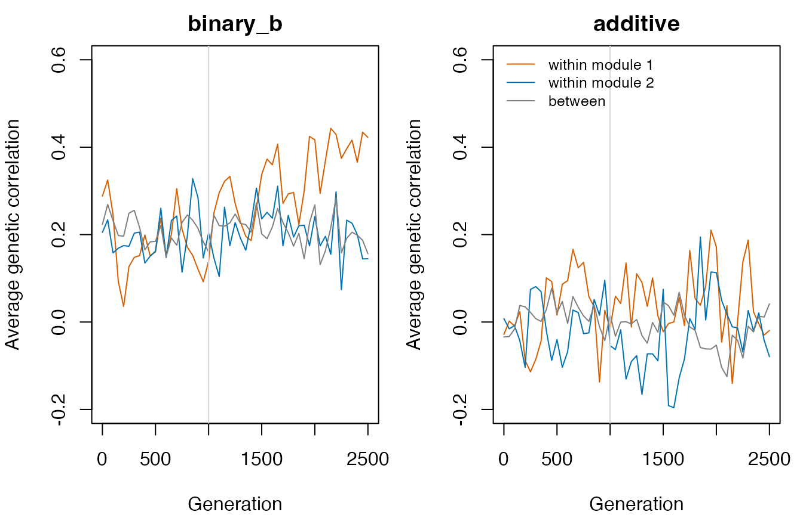
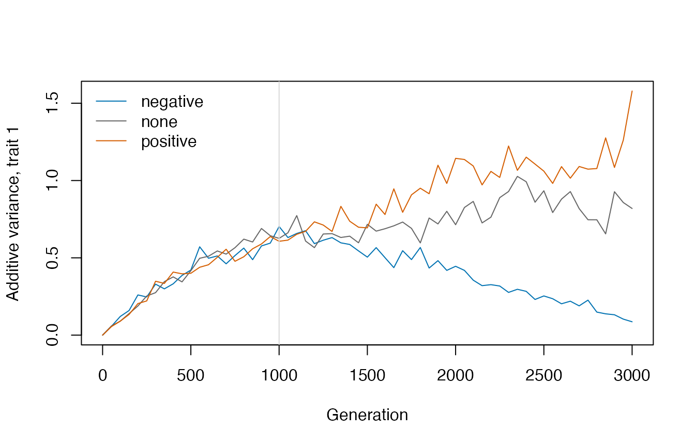
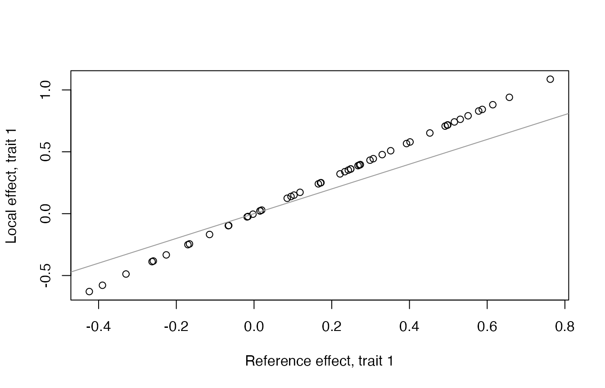

# Genetic architectures, epistasis and linkage

``` r

library(evomod2)
```

The genetic architecture decides how variation is generated and
inherited, and with it how G can evolve. This vignette compares the
three architectures in evomod2 with small simulations, then shows how
recombination affects G. The simulations are short so the vignette
builds quickly; the examples in
`system.file("examples", package = "evomod2")` run longer, replicated
versions.

## Three architectures

All three have diploid loci whose two alleles are added up within the
locus. They differ in what an allele is and how loci combine:

| Architecture | An allele is | Genotypic value | Mutation |
|----|----|----|----|
| [`additive()`](https://diogro.github.io/evomod2/reference/architectures.md) | an effect vector, one value per trait | sum over loci | [`mutation()`](https://diogro.github.io/evomod2/reference/mutation.md): adds a multivariate normal vector |
| [`binary_b()`](https://diogro.github.io/evomod2/reference/architectures.md) | a scalar effect \\y\\ and a 0/1 column of \\B\\ | \\B y\\ | [`binary_b_mutation()`](https://diogro.github.io/evomod2/reference/mutation.md): changes `y`, flips entries of \\B\\ |
| [`multilinear()`](https://diogro.github.io/evomod2/reference/architectures.md) | an effect vector | sum over loci plus pairwise interactions \\\varepsilon(Y_i, Y_j)\\ | [`mutation()`](https://diogro.github.io/evomod2/reference/mutation.md) |

In
[`binary_b()`](https://diogro.github.io/evomod2/reference/architectures.md)
an allele affects the traits marked in its column of \\B\\, all by the
same amount, and \\B\\ mutates, so the pattern of pleiotropy itself can
evolve. In
[`additive()`](https://diogro.github.io/evomod2/reference/architectures.md)
every allele affects every trait with independent effects.
[`multilinear()`](https://diogro.github.io/evomod2/reference/architectures.md)
adds epistasis: the effect of a locus depends on the rest of the genome.

## Pleiotropy and modularity under corridor selection

Four traits, two modules (traits 1-2 and 3-4). After stabilizing
selection, the optimum of module 1 moves (corridor selection):

``` r

corridor <- list(
  stabilizing(1000, omega = 10),
  directional(1500, delta_theta = c(0.004, 0.004, 0, 0), omega = 10)
)
models <- list(
  binary_b = evomod_model(binary_b(loci = 50, traits = 4),
                          binary_b_mutation(rate = 0.001, sd = 0.2, rate_b = 0.0005),
                          env_sd = 0.8, init_sd = 0.2),
  additive = evomod_model(additive(loci = 50, traits = 4),
                          mutation(rate = 0.001, cov = 0.2),
                          env_sd = 0.8, init_sd = 0.2)
)
pops <- lapply(models, evolve, regimes = corridor, n = 500, record_every = 50, seed = 1)
```

Average genetic correlations within and between the modules, through
time:

``` r

module_trace <- function(pop, name) {
  G <- g_matrices(pop)
  do.call(rbind, lapply(names(G), function(gen) {
    a <- avg_corr(G[[gen]], modules = list(1:2, 3:4))
    data.frame(architecture = name, generation = as.integer(gen),
               within_1 = a$within[1], within_2 = a$within[2], between = a$between)
  }))
}
trace <- do.call(rbind, Map(module_trace, pops, names(pops)))

op <- par(mfrow = c(1, 2), mar = c(4, 4, 2, 1))
for (arch in names(pops)) {
  d <- trace[trace$architecture == arch, ]
  matplot(d$generation, d[, c("within_1", "within_2", "between")], type = "l", lty = 1,
          col = c("#D55E00", "#0072B2", "grey50"), ylim = c(-0.2, 0.6),
          xlab = "Generation", ylab = "Average genetic correlation", main = arch)
  abline(v = 1000, col = "grey85")
}
legend("topleft", c("within module 1", "within module 2", "between"),
       col = c("#D55E00", "#0072B2", "grey50"), lty = 1, bty = "n", cex = 0.8)
```



``` r

par(op)
```

With a binary \\B\\, alleles affecting several traits create
correlations, and selection can change which traits alleles affect.
(These are single populations, so the traces are noisy.) In the additive
model, correlations only appear as selection enriches alleles whose
effects on the selected traits point the same way.
`inst/examples/corridor_selection.R` runs this comparison with 20
replicates.

## Multilinear epistasis

With multilinear epistasis the effect of an allele depends on the
genetic background. Positive directional epistasis (here
\\\varepsilon\_{111} \> 0\\) makes substitutions in trait 1 larger as
the population moves in the positive direction, so additive variance
grows under directional selection; negative epistasis shrinks it:

``` r

self_epistasis <- function(e) {
  E <- array(0, c(2, 2, 2))
  E[1, 1, 1] <- e
  E
}
epistasis <- c(negative = -0.05, none = 0, positive = 0.05)
selection <- list(stabilizing(1000, omega = 20),
                  directional(2000, delta_theta = c(0.005, 0), omega = 20))
G11 <- sapply(epistasis, function(e) {
  arch <- if (e == 0) additive(50, 2) else multilinear(50, 2, self_epistasis(e))
  m <- evomod_model(arch, mutation(rate = 0.005, cov = 0.05), env_sd = 1)
  pop <- evolve(m, selection, n = 500, record_every = 50, seed = 2)
  v <- variances(pop)
  v$G[v$trait == "trait1"]
})
gens <- seq(0, 3000, by = 50)   # recorded generations
matplot(gens, G11, type = "l", lty = 1, col = c("#0072B2", "grey40", "#D55E00"),
        xlab = "Generation", ylab = "Additive variance, trait 1")
abline(v = 1000, col = "grey85")
legend("topleft", names(epistasis), col = c("#0072B2", "grey40", "#D55E00"), lty = 1, bty = "n")
```



[`local_effects()`](https://diogro.github.io/evomod2/reference/genomes.md)
gives the effect of each locus in the background of the rest of the
genome. After the population has moved in the positive direction of
trait 1, positive epistasis amplifies every locus effect on trait 1 (by
about \\1 + \varepsilon S\\, where \\S\\ is the sum of the other locus
effects), so local effects lie on a line steeper than 1 when plotted
against the reference effects:

``` r

m <- evomod_model(multilinear(50, 2, self_epistasis(0.05)),
                  mutation(rate = 0.005, cov = 0.05), env_sd = 1)
pop <- evolve(m, selection, n = 500, record_every = 500, seed = 2)
L <- local_effects(pop, individual = 1)
Y <- local_effects(evomod_model(additive(50, 2), mutation(0.1, 0.1)),
                   alleles = genomes(pop)[, , 1])   # reference (additive) effects
plot(Y[1, ], L[1, ], xlab = "Reference effect, trait 1", ylab = "Local effect, trait 1")
abline(0, 1, col = "grey60")
```



## Linkage and the decomposition of G

By default loci recombine freely. A genetic map places loci on
chromosomes:

``` r

linked <- evomod_model(additive(50, 4), mutation(rate = 0.001, cov = 0.2),
                       env_sd = 0.8, init_sd = 0.2,
                       recombination = genetic_map(chromosomes = 1, length = 0.5))
linked$recombination$rates[1:3]   # between neighbouring loci
#> [1] 0.01010066 0.01010066 0.01010066
```

G splits into a genic part, the G expected without linkage
disequilibrium, and the part due to linkage disequilibrium between loci.
Stabilizing selection builds negative linkage disequilibrium that hides
part of the genic variance (the Bulmer effect), much more strongly when
loci are linked:

``` r

free <- evomod_model(additive(50, 4), mutation(rate = 0.001, cov = 0.2),
                     env_sd = 0.8, init_sd = 0.2)
stab <- stabilizing(1500, omega = 5)
decomp <- sapply(list(free = free, linked = linked), function(m) {
  d <- g_decomposition(evolve(m, stab, n = 500, record_every = 500, seed = 3))
  c(G = d$G[1, 1], genic = d$genic[1, 1], ld = d$ld[1, 1])
})
round(decomp, 3)
#>        free linked
#> G     0.381  0.359
#> genic 0.370  0.715
#> ld    0.011 -0.356
```

`g_matrices(pop, "genic")` and `g_matrices(pop, "ld")` give the two
parts at every recorded generation. `inst/examples/corridor_linkage.R`
compares the binary B and additive architectures under free
recombination and tight linkage.

For architectures where genotypic values are not sums of allele effects
(multilinear epistasis), the same split can be estimated by shuffling
alleles among individuals at each locus (do O & Whitlock 2023). Here for
the population with positive epistasis from the previous section:

``` r

lapply(g_decomposition(pop, method = "shuffle", shuffles = 10), round, 3)
#> $G
#>        trait1 trait2
#> trait1  1.579  0.027
#> trait2  0.027  0.712
#> 
#> $genic
#>        trait1 trait2
#> trait1  1.533  0.006
#> trait2  0.006  0.741
#> 
#> $ld
#>        trait1 trait2
#> trait1  0.046  0.021
#> trait2  0.021 -0.029
```

## Mutational covariance

New mutations have effects that depend on the genetic background when
there is epistasis.
[`mutational_covariance()`](https://diogro.github.io/evomod2/reference/mutational_covariance.md)
applies single mutations to genomes of the population and measures their
effects. In the additive model the covariance of the effects of one
mutation is the mutational covariance of the model (\\0.05^2\\ here);
with positive directional epistasis, after the population moved in the
positive direction of trait 1, a mutation of size \\d\\ at trait 1
changes the trait by \\d\\(1 + \varepsilon (S - Y_l))\\, so mutational
effects are larger (their mean stays zero, because the map is linear in
each locus):

``` r

add <- evomod_model(additive(50, 2), mutation(rate = 0.005, cov = 0.05), env_sd = 1)
pop_add <- evolve(add, selection, n = 500, record_every = 500, seed = 2)
mc <- list(additive = mutational_covariance(pop_add, n = 20000),
           epistatic = mutational_covariance(pop, n = 20000))
signif(sapply(mc, function(x) c(var_trait1 = x$per_mutation[1, 1], mean_trait1 = x$mean[[1]])), 2)
#>             additive epistatic
#> var_trait1   2.5e-03    0.0049
#> mean_trait1 -4.3e-05   -0.0006
```
