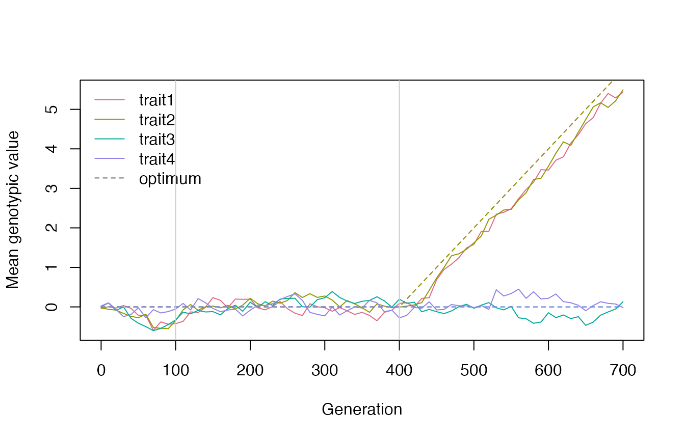
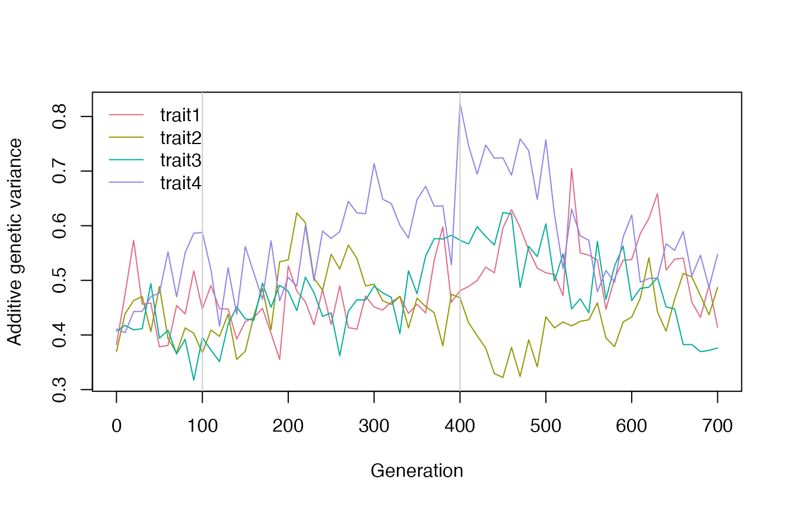
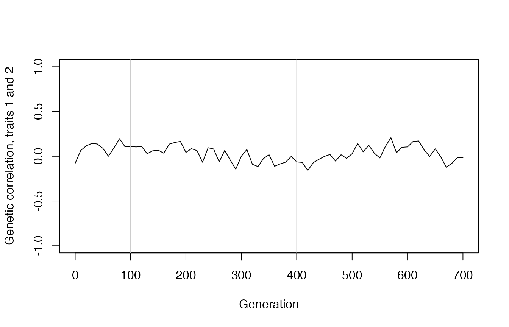

# Getting started with evomod2

evomod2 simulates populations of diploid individuals whose multivariate
phenotypes evolve under drift and Gaussian selection. Every simulation
has the same three ingredients:

1.  a **model**: genetic architecture, mutation, recombination and
    environmental noise;
2.  a list of **selection regimes**;
3.  a call to
    **[`evolve()`](https://diogro.github.io/evomod2/reference/evolve.md)**,
    which returns a population with statistics recorded along the way.

This vignette walks through each one with small, fast simulations. The
other vignettes compare genetic architectures
([`vignette("architectures")`](https://diogro.github.io/evomod2/articles/architectures.md))
and reproduce the simulations of Melo & Marroig (2015)
([`vignette("melo-marroig-2015")`](https://diogro.github.io/evomod2/articles/melo-marroig-2015.md)).

``` r

library(evomod2)
```

## Models

A genetic architecture says how genomes map to genotypic values `x`. In
the **additive** architecture, each allele carries an effect vector with
one value per trait, and `x` is the sum of the effect vectors of all
alleles. Mutation adds a multivariate normal vector to an allele’s
effects.

``` r

model <- evomod_model(
  architecture = additive(loci = 20, traits = 4),
  mutation = mutation(rate = 0.005, cov = 0.1),  # cov: sd 0.1 per trait, uncorrelated
  env_sd = 0.8,                                  # phenotype z = x + Normal(0, 0.8^2)
  init_sd = 0.1                                  # starting allelic effects
)
model
#> <evomod model>
#>   architecture: additive - 20 loci, 4 traits
#>   mutation:     rate 0.005 per allele, random walk 
#>   recombination: free 
#>   life cycle:   wright_fisher 
#>   env_sd:       0.8   init_sd: 0.1
```

Generations are discrete by default; `life_cycle = moran()` gives
overlapping generations, where each generation is `n` birth-death events
(see
[`?life_cycles`](https://diogro.github.io/evomod2/reference/life_cycles.md)).
Other architectures are
[`binary_b()`](https://diogro.github.io/evomod2/reference/architectures.md),
the binary ontogenetic matrix of the original evomod model (with
[`binary_b_mutation()`](https://diogro.github.io/evomod2/reference/mutation.md)),
and
[`multilinear()`](https://diogro.github.io/evomod2/reference/architectures.md),
pairwise multilinear epistasis (see
[`?architectures`](https://diogro.github.io/evomod2/reference/architectures.md)).
Loci recombine freely unless the model has a genetic map
([`?recombination`](https://diogro.github.io/evomod2/reference/recombination.md)).

## Selection regimes

Fitness is Gaussian around an optimum `theta`, with covariance `omega`
(larger `omega` means weaker selection):

``` r

omega <- diag(10, 4)
regimes <- list(
  drift(100),                                                  # no selection
  stabilizing(300, omega = omega),                             # fixed optimum
  directional(300, delta_theta = c(0.02, 0.02, 0, 0), omega = omega)  # moving optimum
)
```

[`directional()`](https://diogro.github.io/evomod2/reference/regimes.md)
moves the optimum by `delta_theta` every generation; here traits 1 and 2
are pushed up while traits 3 and 4 stay put.
[`fluctuating()`](https://diogro.github.io/evomod2/reference/regimes.md)
makes the optimum jump up or down every few generations, for all traits
together, independently, or in blocks (as in do O & Whitlock 2023):

``` r

fluctuating(5000, every = 10, step = 0.2, omega = 1, structure = list(1:2, 3:4))
#> <evomod regime> fluctuating for 5000 generations
```

## Running a simulation

``` r

pop <- evolve(model, regimes, n = 300, record_every = 10, seed = 1)
pop
#> <evomod population> 300 individuals at generation 700 
#>   architecture: additive - 20 loci, 4 traits
#>   regimes: drift (100), stabilizing (300), directional (300) 
#>   records: 71 generations
```

Statistics are recorded every `record_every` generations:

``` r

head(trait_means(pop))
#>   generation  trait       mean_x        mean_z theta
#> 1          0 trait1 -0.042971769 -0.0563562556     0
#> 2          0 trait2 -0.022712704 -0.0391483171     0
#> 3          0 trait3  0.008942121 -0.0153788330     0
#> 4          0 trait4  0.024249932  0.0858234510     0
#> 5         10 trait1  0.004493161  0.0004336258     0
#> 6         10 trait2 -0.061181608 -0.0014832862     0
tail(variances(pop))
#>     generation  trait         G         P        h2
#> 279        690 trait3 0.3717994 0.9405393 0.3953045
#> 280        690 trait4 0.4871923 1.0276138 0.4741006
#> 281        700 trait1 0.4140055 1.0076001 0.4108828
#> 282        700 trait2 0.4869124 1.2187075 0.3995318
#> 283        700 trait3 0.3761608 0.9690206 0.3881866
#> 284        700 trait4 0.5476366 1.2227502 0.4478728
g_matrices(pop)[["700"]]
#>              trait1       trait2      trait3      trait4
#> trait1  0.414005526 -0.007438328  0.02785657 0.103344112
#> trait2 -0.007438328  0.486912444 -0.10005839 0.008561561
#> trait3  0.027856569 -0.100058389  0.37616079 0.023234865
#> trait4  0.103344112  0.008561561  0.02323486 0.547636554
```

[`plot()`](https://rdrr.io/r/graphics/plot.default.html) shows mean
genotypic values against the optimum, additive variances, or a genetic
correlation (grey lines mark the regime boundaries):

``` r

plot(pop)
```



``` r

plot(pop, "variances")
```



``` r

plot(pop, "correlation", traits = c(1, 2))
```



## Continuing a population

[`evolve()`](https://diogro.github.io/evomod2/reference/evolve.md) also
takes a population and continues it: same individuals, generation count,
optimum and records.

``` r

pop <- evolve(pop, stabilizing(200, omega = omega))
pop
#> <evomod population> 300 individuals at generation 900 
#>   architecture: additive - 20 loci, 4 traits
#>   regimes: drift (100), stabilizing (300), directional (300), stabilizing (200) 
#>   records: 91 generations
```

Runs are reproducible: random numbers come from R’s generator, so the
same `seed` (or [`set.seed()`](https://rdrr.io/r/base/Random.html))
gives the same result, and continuing a population in two steps gives
the same result as running it in one.

## Genomes and G matrix statistics

The current genomes are available as an array (rows x alleles x
individuals; alleles `2l - 1` and `2l` are the two copies of locus `l`):

``` r

dim(genomes(pop))
#> [1]   4  40 300
```

For architectures where genotypic values are sums of allele effects, G
splits into a genic part (expected without linkage disequilibrium) and a
linkage disequilibrium part:

``` r

dec <- g_decomposition(pop)
round(dec$genic, 3)
#>        trait1 trait2 trait3 trait4
#> trait1  0.409  0.012  0.022  0.102
#> trait2  0.012  0.400 -0.113 -0.013
#> trait3  0.022 -0.113  0.442  0.012
#> trait4  0.102 -0.013  0.012  0.640
round(dec$ld, 3)
#>        trait1 trait2 trait3 trait4
#> trait1 -0.029 -0.022  0.018  0.035
#> trait2 -0.022 -0.001  0.015 -0.073
#> trait3  0.018  0.015 -0.067  0.028
#> trait4  0.035 -0.073  0.028 -0.008
```

Matrix statistics for modularity and evolvability:

``` r

G <- dec$G
avg_corr(G, modules = list(1:2, 3:4))   # within- and between-module correlations
#> $within
#> [1] -0.02605202  0.08265489
#> 
#> $between
#> [1] -0.009818828
#> 
#> $avg_ratio
#> [1] -2.882364
autonomy(G, c(1, 1, 0, 0))               # autonomy in the direction of module 1
#> [1] 0.980875
mean_autonomy(G)                         # mean over random directions
#> [1] 0.9137727
eigen_variance(G)                        # proportion of variance per eigenvector
#> [1] 0.4095508 0.2504928 0.1902026 0.1497538
```

## Larger simulations

The examples in `system.file("examples", package = "evomod2")` run
larger, replicated experiments from the command line, one replicate per
process, so they can run in parallel:

``` r

list.files(system.file("examples", package = "evomod2"))
#> [1] "corridor_linkage.R"         "corridor_selection.R"      
#> [3] "fluctuating_environments.R" "jones_burger_arnold_2014.R"
#> [5] "melo_marroig_2015.R"
```
