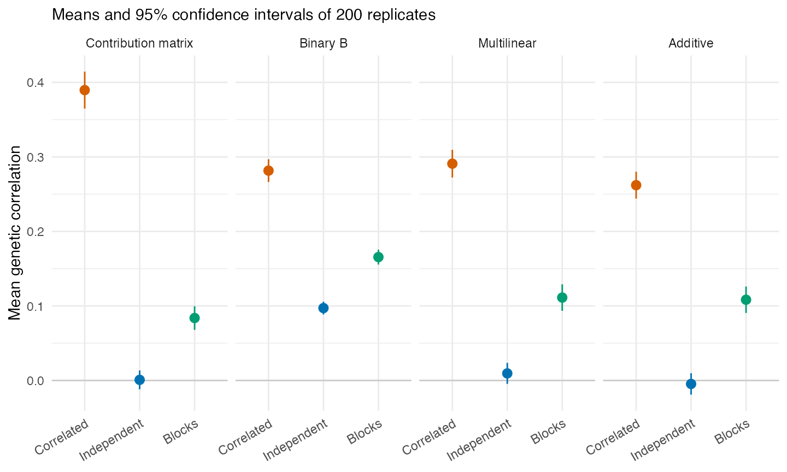
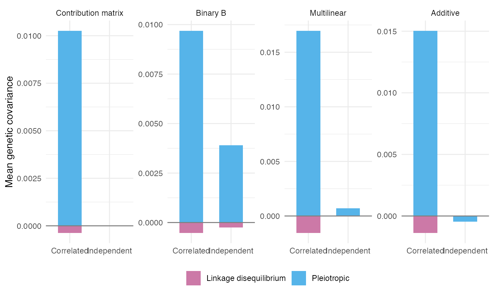
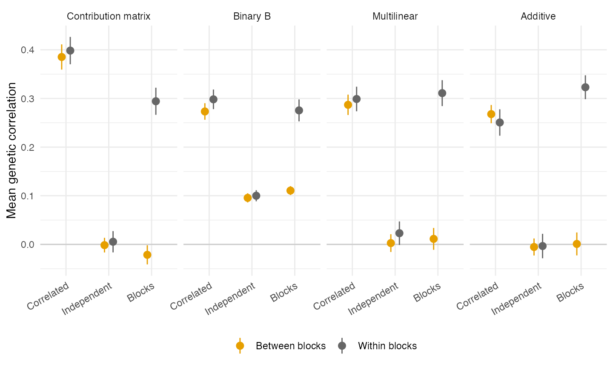
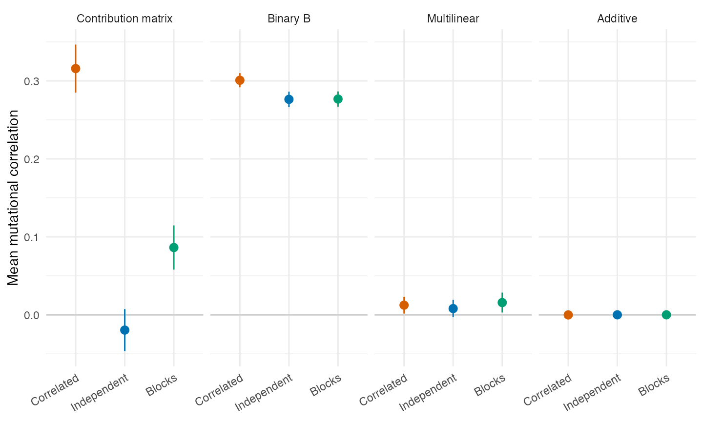
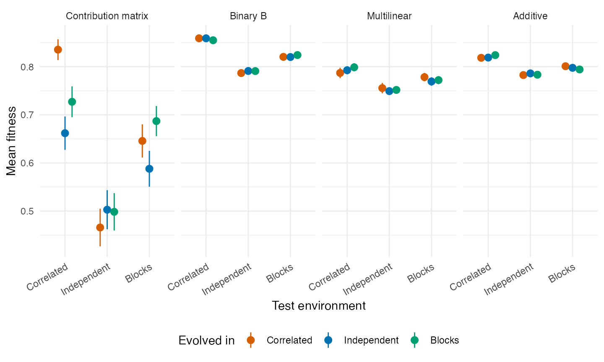

# Fluctuating environments across genetic architectures

do O & Whitlock (2023, *Evolution Letters* 7: 457-466) simulated
populations whose optimum jumps every few generations, either for all
traits together (correlated change) or for each trait on its own
(independent change), with a genotype-phenotype map that lets pleiotropy
evolve: weight genes \\a\\ and a matrix of contribution genes \\C\\, \\z
= C a\\. They concluded that

1.  correlated change gives more genetic covariance than independent
    change;
2.  most of the difference is pleiotropic, not linkage disequilibrium;
3.  block-correlated change (traits 1-2 together, 3-4 together) gives
    modularity;
4.  the mutational covariance evolves to match the environment, through
    the epistasis between weight and contribution genes;
5.  populations do best in the kind of environment they evolved in.

Their argument rests on pleiotropy being able to evolve. This vignette
tests the claims with four architectures that differ in exactly that:

| Architecture | Pleiotropy | Role |
|----|----|----|
| [`contribution_matrix()`](https://diogro.github.io/evomod2/reference/architectures.md) | continuous, evolves (their model) | replication |
| [`binary_b()`](https://diogro.github.io/evomod2/reference/architectures.md) | binary, evolves (Melo & Marroig 2015) | independent test |
| [`multilinear()`](https://diogro.github.io/evomod2/reference/architectures.md) | fixed pattern; random epistasis makes mutational effects depend on the background | intermediate |
| [`additive()`](https://diogro.github.io/evomod2/reference/architectures.md) | fixed, isotropic mutational covariance | control |

The simulations run in a few hours of computing, so this vignette shows
the results of a run stored in the package. The script
`fluctuating_environments.R` in
`system.file("examples", package = "evomod2")` runs them.

## Setup

The scales follow do O & Whitlock: four traits, 1000 individuals, 5000
generations; every 10 generations the optimum moves by 0.2 up or down,
within \\\[-1, 1\]\\; \\\Omega = I\\; no environmental noise; 0.01
mutations per individual per generation, of standard deviation 0.5 (the
value used in their code, which the paper describes as a variance). The
other architectures have 20 loci, like their 20 genes, and the same
mutational input.

``` r

library(evomod2)
environment <- fluctuating(5000, every = 10, step = 0.2, omega = diag(4),
                           structure = "correlated",   # or "independent", list(1:2, 3:4)
                           bounds = c(-1, 1))
model <- evomod_model(contribution_matrix(traits = 4),
                      contribution_mutation(rate_weight = 0.005 / 8,
                                            rate_contribution = 0.005 / 32, sd = 0.5))
pop <- evolve(model, environment, n = 1000, record_every = 10)
```

Statistics are averaged over the last 500 generations:

- **genetic covariances and correlations** among traits
  ([`g_matrices()`](https://diogro.github.io/evomod2/reference/statistics.md)),
  within and between the blocks 1-2 and 3-4;
- their **pleiotropic and linkage disequilibrium parts**, by shuffling
  alleles among individuals (`g_decomposition(method = "shuffle")`), as
  do O & Whitlock did;
- the **mutational covariance**, the covariance of the effects of single
  new mutations in the evolved population
  ([`mutational_covariance()`](https://diogro.github.io/evomod2/reference/mutational_covariance.md));
- **fitness in each environment**: the evolved population, with
  pleiotropy frozen (no mutations of \\C\\ or \\B\\), is moved to each
  kind of environment for 2000 generations with an unbounded optimum,
  and its mean fitness is averaged over the last 200.

## 1. Correlated change and genetic covariance

``` r

d <- mean_ci(res, "G_cor", c("architecture", "environment"))
ggplot(d, aes(environment, mean, colour = environment)) +
  geom_hline(yintercept = 0, colour = "grey80") +
  geom_pointrange(aes(ymin = lo, ymax = hi)) +
  facet_wrap(~ architecture, nrow = 1) +
  scale_colour_manual(values = env_colours, guide = "none") +
  labs(x = NULL, y = "Mean genetic correlation",
       subtitle = sprintf("Means and 95%% confidence intervals of %d replicates", n_rep)) +
  theme(axis.text.x = element_text(angle = 30, hjust = 1))
```



Mean genetic covariance and variance, correlated and independent change:

``` r

tab <- aggregate(cbind(G_cov, G_var) ~ architecture + environment,
                 res[res$environment != "Blocks", ], mean)
tab[order(tab$architecture), ]
#>          architecture environment         G_cov      G_var
#> 1 Contribution matrix  Correlated  9.428883e-03 0.02568672
#> 5 Contribution matrix Independent  4.693548e-05 0.03411071
#> 2            Binary B  Correlated  8.899311e-03 0.03205233
#> 6            Binary B Independent  3.610274e-03 0.03891932
#> 3         Multilinear  Correlated  1.464695e-02 0.05467128
#> 7         Multilinear Independent  5.663761e-04 0.06576999
#> 4            Additive  Correlated  1.340578e-02 0.05358520
#> 8            Additive Independent -4.447450e-04 0.06432943
```

## 2. Pleiotropy or linkage disequilibrium?

``` r

parts <- rbind(
  data.frame(res[c("architecture", "environment")], part = "Pleiotropic", value = res$pleio_cov),
  data.frame(res[c("architecture", "environment")], part = "Linkage disequilibrium", value = res$ld_cov))
d <- mean_ci(parts[parts$environment != "Blocks", ], "value", c("architecture", "environment", "part"))
ggplot(d, aes(environment, mean, fill = part)) +
  geom_col(position = "stack", width = 0.6) +
  geom_hline(yintercept = 0, colour = "grey50") +
  facet_wrap(~ architecture, nrow = 1, scales = "free_y") +
  scale_fill_manual(values = c("#CC79A7", "#56B4E9"), name = NULL) +
  labs(x = NULL, y = "Mean genetic covariance") +
  theme(legend.position = "bottom")
```



## 3. Modularity under block-correlated change

Mean genetic correlation within the blocks (traits 1-2, 3-4) and between
them:

``` r

blocks <- rbind(
  data.frame(res[c("architecture", "environment")], pair = "Within blocks", value = res$G_cor_within),
  data.frame(res[c("architecture", "environment")], pair = "Between blocks", value = res$G_cor_between))
d <- mean_ci(blocks, "value", c("architecture", "environment", "pair"))
ggplot(d, aes(environment, mean, colour = pair)) +
  geom_hline(yintercept = 0, colour = "grey80") +
  geom_pointrange(aes(ymin = lo, ymax = hi), position = position_dodge(width = 0.4)) +
  facet_wrap(~ architecture, nrow = 1) +
  scale_colour_manual(values = c("#E69F00", "grey40"), name = NULL) +
  labs(x = NULL, y = "Mean genetic correlation") +
  theme(legend.position = "bottom", axis.text.x = element_text(angle = 30, hjust = 1))
```



## 4. Mutational covariance

Mean correlation between the effects of a new mutation on different
traits, in the evolved populations. In the additive control the
mutational covariance is fixed (isotropic), so this is zero by
construction:

``` r

d <- mean_ci(res, "M_cor", c("architecture", "environment"))
ggplot(d, aes(environment, mean, colour = environment)) +
  geom_hline(yintercept = 0, colour = "grey80") +
  geom_pointrange(aes(ymin = lo, ymax = hi)) +
  facet_wrap(~ architecture, nrow = 1) +
  scale_colour_manual(values = env_colours, guide = "none") +
  labs(x = NULL, y = "Mean mutational correlation") +
  theme(axis.text.x = element_text(angle = 30, hjust = 1))
```



## 5. Fitness in each kind of environment

Mean fitness of populations evolved in each environment (rows) when
moved to each environment (columns), with pleiotropy frozen:

``` r

fit <- do.call(rbind, lapply(c("correlated", "independent", "blocks"), function(test)
  data.frame(res[c("architecture", "environment")], test = env_labels[[test]],
             value = res[[paste0("fitness_", test)]])))
fit$test <- factor(fit$test, env_labels)
d <- mean_ci(fit, "value", c("architecture", "environment", "test"))
ggplot(d, aes(test, mean, colour = environment)) +
  geom_pointrange(aes(ymin = lo, ymax = hi), position = position_dodge(width = 0.5)) +
  facet_wrap(~ architecture, nrow = 1) +
  scale_colour_manual(values = env_colours, name = "Evolved in") +
  labs(x = "Test environment", y = "Mean fitness") +
  theme(legend.position = "bottom", axis.text.x = element_text(angle = 30, hjust = 1))
```



## What the architectures say

- **Claims 1-3 hold for every architecture, including the additive
  control.** Correlated change raised the mean genetic correlation from
  0.00 to 0.26 in the additive model, whose mutational covariance cannot
  evolve, and from 0.00 to 0.39 with the contribution matrix.
  Block-correlated change made G modular in all four (additive: 0.32
  within blocks, 0.00 between). In the shuffle decomposition the
  difference is pleiotropic in every architecture, including the
  additive one. There, the pleiotropic part is not a change in how genes
  affect traits: selection sorts alleles, enriching those whose
  (randomly drawn) effects on different traits point the same way, as
  Jones et al. (2004) described for a fixed mutational covariance. So
  more covariance, modularity and a pleiotropic basis of G do not, on
  their own, show that pleiotropy evolved.

- **Claims 4 and 5 hold only for the contribution matrix.** Its
  mutational correlation followed the environment (0.32 after correlated
  change, -0.02 after independent change, and 0.31 within blocks against
  -0.03 between them after block-correlated change), and with pleiotropy
  frozen, populations did best in correlated and block-correlated
  environments if they had evolved in them (in correlated environments,
  0.84 if they evolved under correlated change against 0.66 under
  independent change); in independent environments, populations from all
  three histories had similar fitness. In the binary B model the
  mutational correlation stayed near 0.30 in every environment (alleles
  affect several traits in the same direction, whatever the environment)
  and populations from different environments had the same fitness. In
  the additive and multilinear models the mutational covariance barely
  changes, and there was no home advantage either.

- The evolution of the mutational covariance, and the lasting advantage
  it gives, needs a developmental map in which the direction of
  pleiotropic effects can evolve continuously, as in do O & Whitlock’s
  model. Genetic covariance and modularity in G do not need it.

- Correlated-over-independent covariance ratios (do O & Whitlock report
  16-19) are not a good measure here: under independent change the mean
  covariance is close to zero, so the ratio is unstable. Differences in
  correlation are more informative.

These runs differ from do O & Whitlock’s in the life cycle: evomod2 has
diploid individuals and discrete generations, their model haploid
individuals and overlapping generations (one birth and one death at a
time).

## Running it

``` sh
script=$(Rscript -e 'cat(system.file("examples", "fluctuating_environments.R", package = "evomod2"))')
Rscript $script simulate contribution_matrix correlated 1 results   # one replicate
Rscript $script summarise results fluctuating_environments.rds
```

Each replicate takes 10-20 seconds; run them in parallel, one per
process.
