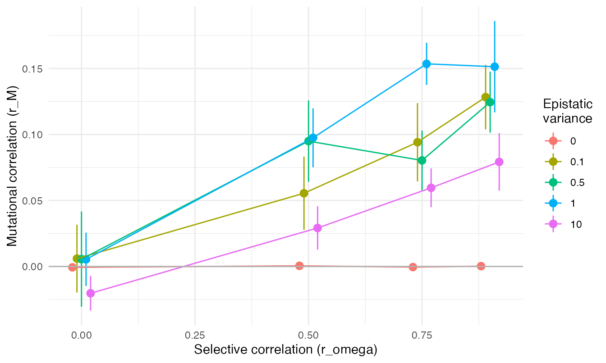
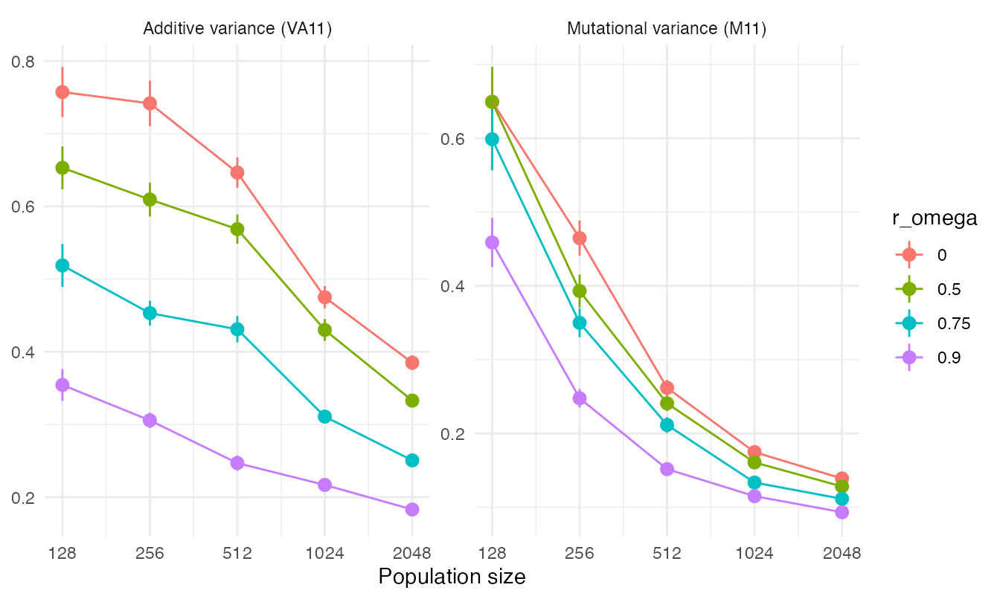
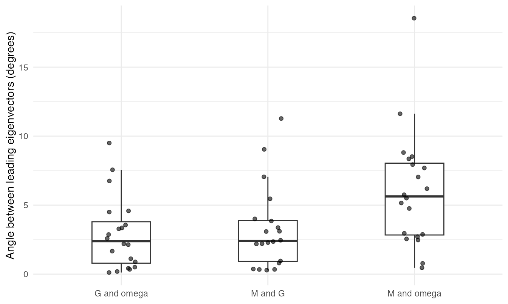
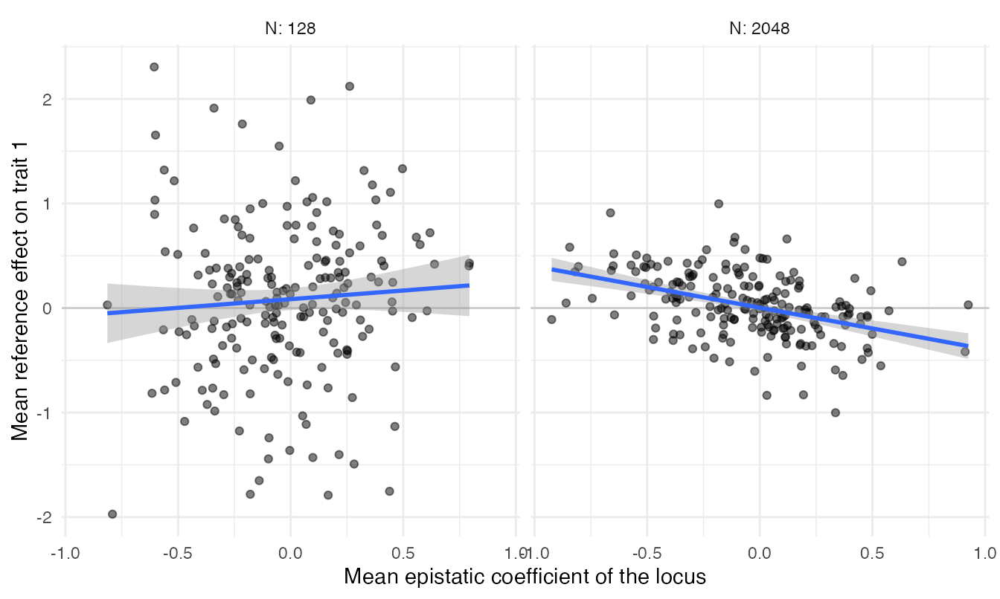
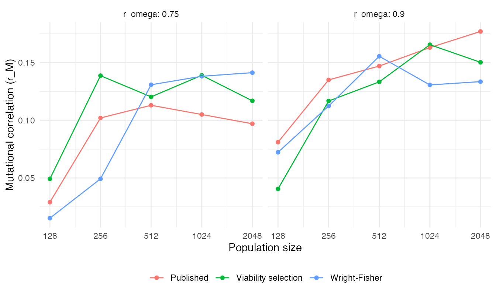

# Reproducing Jones, Bürger & Arnold (2014)

Jones, Bürger & Arnold (2014, *Nature Communications* 5: 3709,
[doi:10.1038/ncomms4709](https://doi.org/10.1038/ncomms4709)) asked how
epistasis and selection shape the mutational variance-covariance matrix,
**M**. With epistasis, the effect of a new mutation depends on the
genetic background, so M can evolve. They found that

- epistasis inflates mutational variance;
- correlational selection makes M correlated, aligned with the selection
  surface, but only when there is epistasis: without it M is fixed;
- smaller populations evolve larger mutational variances;
- the leading eigenvectors of M, G and the selection surface (omega)
  align;
- in large populations, loci with larger effects have more negative
  epistatic coefficients.

This vignette repeats their simulations with evomod2. They take about an
hour of computing in total, so the vignette shows results stored in the
package; the script `jones_burger_arnold_2014.R` in
`system.file("examples", package = "evomod2")` runs them.

## Model

Two traits are affected by 20 unlinked diploid loci. Each locus has a
reference effect vector (the sum of its two alleles), and every pair of
loci interacts through its own random tensor of epistatic coefficients,
drawn once per run from a normal distribution with mean 0 and variance
\\\sigma\_\varepsilon^2\\:

\\x = \sum_i y_i + \sum\_{i\<j} \varepsilon\_{ij}(y_i, y_j)\\

In evomod2 this is
[`multilinear()`](https://diogro.github.io/evomod2/reference/architectures.md)
with coefficients from
[`pairwise_epsilon()`](https://diogro.github.io/evomod2/reference/pairwise_epsilon.md):

``` r

library(evomod2)
sigma2 <- 1                       # variance of epistatic coefficients
r_omega <- 0.9                    # correlation of the selection surface
model <- evomod_model(
  multilinear(loci = 20, traits = 2, epsilon = pairwise_epsilon(20, 2, sd = sqrt(sigma2))),
  mutation(rate = 0.0005, cov = diag(0.05, 2)),   # added to reference effects
  env_sd = 1)
omega <- 49 * matrix(c(1, r_omega, r_omega, 1), 2)
pop <- evolve(model, stabilizing(10000, omega = omega), n = 512)
additive_covariance(pop)          # G and its additive part
mutational_covariance(pop)        # M: effects of single new mutations
```

Parameters follow their Table 1: mutational variance 0.05 per trait (no
mutational correlation), \\\mu = 0.0005\\ per locus, \\\omega\_{11} =
\omega\_{22} = 49\\, environmental variance 1, \\N = 512\\; each locus
starts with five equally frequent alleles of small effect; 5000
generations of burn-in, then 5000 in which G, its additive part and M
are measured 20 times and averaged; 20 runs per setting.

Two things can differ from their simulations:

- **Reproduction.** By default evomod2 draws parents in proportion to
  fitness each generation
  ([`wright_fisher()`](https://diogro.github.io/evomod2/reference/life_cycles.md)).
  Their life cycle, in which each female mates with two males and has
  four offspring, followed by viability selection and regulation to
  \\K\\ individuals, is available as
  [`viability_selection()`](https://diogro.github.io/evomod2/reference/life_cycles.md);
  the results below use the default, and a later section repeats Tables
  2 and 3 with their life cycle.
- **Additive variance.** They estimated it from a half-sib design; here
  it is the least-squares additive covariance
  ([`additive_covariance()`](https://diogro.github.io/evomod2/reference/additive_covariance.md)),
  the variance of the best linear prediction of genotypic values from
  the loci.

## Epistasis and correlational selection (their Table 2)

Means over 20 runs, \\N = 512\\, for each variance of the epistatic
coefficients (\\\sigma\_\varepsilon^2\\, `sigma2`) and selective
correlation (\\r\_\omega\\, `r_omega`):

``` r

t2 <- avg(res$table2, c("sigma2", "r_omega"))
knitr::kable(t2, digits = 3, row.names = FALSE)
```

| sigma2 | r_omega |  VG11 |  VG22 |     rG |  VA11 |  VA22 |     rA |   M11 |   M22 |     rM |
|-------:|--------:|------:|------:|-------:|------:|------:|-------:|------:|------:|-------:|
|    0.0 |    0.00 | 0.526 | 0.508 | -0.003 | 0.526 | 0.508 | -0.003 | 0.050 | 0.050 | -0.001 |
|    0.0 |    0.50 | 0.467 | 0.485 |  0.158 | 0.467 | 0.485 |  0.158 | 0.050 | 0.050 |  0.001 |
|    0.0 |    0.75 | 0.389 | 0.393 |  0.257 | 0.389 | 0.393 |  0.257 | 0.050 | 0.050 |  0.000 |
|    0.0 |    0.90 | 0.310 | 0.301 |  0.430 | 0.310 | 0.301 |  0.430 | 0.050 | 0.050 |  0.000 |
|    0.1 |    0.00 | 0.607 | 0.616 | -0.008 | 0.571 | 0.580 | -0.008 | 0.108 | 0.117 |  0.006 |
|    0.1 |    0.50 | 0.573 | 0.547 |  0.232 | 0.541 | 0.515 |  0.244 | 0.102 | 0.101 |  0.055 |
|    0.1 |    0.75 | 0.423 | 0.433 |  0.325 | 0.400 | 0.410 |  0.344 | 0.095 | 0.097 |  0.094 |
|    0.1 |    0.90 | 0.322 | 0.320 |  0.481 | 0.306 | 0.304 |  0.505 | 0.081 | 0.084 |  0.128 |
|    0.5 |    0.00 | 0.725 | 0.680 | -0.018 | 0.642 | 0.596 | -0.020 | 0.211 | 0.199 |  0.006 |
|    0.5 |    0.50 | 0.611 | 0.645 |  0.210 | 0.532 | 0.565 |  0.236 | 0.185 | 0.189 |  0.095 |
|    0.5 |    0.75 | 0.450 | 0.439 |  0.307 | 0.393 | 0.382 |  0.346 | 0.159 | 0.148 |  0.080 |
|    0.5 |    0.90 | 0.308 | 0.308 |  0.468 | 0.275 | 0.275 |  0.522 | 0.125 | 0.129 |  0.124 |
|    1.0 |    0.00 | 0.729 | 0.719 |  0.003 | 0.610 | 0.600 |  0.004 | 0.253 | 0.252 |  0.005 |
|    1.0 |    0.50 | 0.639 | 0.652 |  0.211 | 0.541 | 0.557 |  0.242 | 0.261 | 0.265 |  0.097 |
|    1.0 |    0.75 | 0.507 | 0.490 |  0.340 | 0.430 | 0.413 |  0.397 | 0.204 | 0.200 |  0.154 |
|    1.0 |    0.90 | 0.299 | 0.309 |  0.444 | 0.257 | 0.268 |  0.508 | 0.155 | 0.157 |  0.151 |
|   10.0 |    0.00 | 0.712 | 0.710 | -0.020 | 0.471 | 0.479 | -0.024 | 0.524 | 0.519 | -0.020 |
|   10.0 |    0.50 | 0.640 | 0.619 |  0.139 | 0.448 | 0.429 |  0.191 | 0.504 | 0.494 |  0.029 |
|   10.0 |    0.75 | 0.422 | 0.407 |  0.210 | 0.291 | 0.279 |  0.277 | 0.407 | 0.378 |  0.060 |
|   10.0 |    0.90 | 0.242 | 0.235 |  0.296 | 0.175 | 0.170 |  0.374 | 0.309 | 0.296 |  0.079 |

Published values for some of the same settings (their Table 2, \\N =
512\\):

``` r

published2 <- data.frame(
  sigma2 = c(0, 0, 1, 1, 0.1, 0.1, 0.1, 10, 10),
  r_omega = c(0, 0.9, 0, 0.9, 0.5, 0.75, 0.9, 0, 0.9),
  M11 = c(0.05, 0.05, 0.267, 0.168, NA, NA, NA, 0.565, 0.282),
  rM = c(0, 0, -0.002, 0.141, 0.038, 0.095, 0.120, 0.005, 0.074),
  VG11 = c(0.53, 0.30, NA, 0.31, NA, NA, NA, NA, NA),
  rG = c(NA, 0.420, NA, 0.441, NA, NA, NA, NA, NA))
keys <- published2[c("sigma2", "r_omega")]
knitr::kable(data.frame(keys,
                        M11 = published2$M11, M11_evomod2 = lookup(keys, t2, "M11"),
                        rM = published2$rM, rM_evomod2 = lookup(keys, t2, "rM"),
                        VG11 = published2$VG11, VG11_evomod2 = lookup(keys, t2, "VG11")),
             digits = 3, row.names = FALSE)
```

| sigma2 | r_omega |   M11 | M11_evomod2 |     rM | rM_evomod2 | VG11 | VG11_evomod2 |
|-------:|--------:|------:|------------:|-------:|-----------:|-----:|-------------:|
|    0.0 |    0.00 | 0.050 |       0.050 |  0.000 |     -0.001 | 0.53 |        0.526 |
|    0.0 |    0.90 | 0.050 |       0.050 |  0.000 |      0.000 | 0.30 |        0.310 |
|    1.0 |    0.00 | 0.267 |       0.253 | -0.002 |      0.005 |   NA |        0.729 |
|    1.0 |    0.90 | 0.168 |       0.155 |  0.141 |      0.151 | 0.31 |        0.299 |
|    0.1 |    0.50 |    NA |       0.102 |  0.038 |      0.055 |   NA |        0.573 |
|    0.1 |    0.75 |    NA |       0.095 |  0.095 |      0.094 |   NA |        0.423 |
|    0.1 |    0.90 |    NA |       0.081 |  0.120 |      0.128 |   NA |        0.322 |
|   10.0 |    0.00 | 0.565 |       0.524 |  0.005 |     -0.020 |   NA |        0.712 |
|   10.0 |    0.90 | 0.282 |       0.309 |  0.074 |      0.079 |   NA |        0.242 |

``` r

d <- res$table2
d$sigma2 <- factor(d$sigma2)
ggplot(d, aes(r_omega, rM, colour = sigma2)) +
  stat_summary(fun.data = mean_se, position = position_dodge(width = 0.05)) +
  stat_summary(fun = mean, geom = "line", position = position_dodge(width = 0.05)) +
  geom_hline(yintercept = 0, colour = "grey70") +
  labs(x = "Selective correlation (r_omega)", y = "Mutational correlation (r_M)",
       colour = "Epistatic\nvariance")
```



## Population size (their Table 3 and Fig. 1)

Means over 20 runs, with \\\sigma\_\varepsilon^2 = 1\\:

``` r

t3 <- avg(res$table3, c("N", "r_omega"))
knitr::kable(t3, digits = 3, row.names = FALSE)
```

|    N | r_omega |  VG11 |  VG22 |     rG |  VA11 |  VA22 |     rA |   M11 |   M22 |     rM |
|-----:|--------:|------:|------:|-------:|------:|------:|-------:|------:|------:|-------:|
|  128 |    0.00 | 0.773 | 0.703 | -0.024 | 0.757 | 0.687 | -0.024 | 0.650 | 0.621 | -0.009 |
|  128 |    0.50 | 0.667 | 0.623 |  0.180 | 0.653 | 0.610 |  0.184 | 0.649 | 0.602 | -0.002 |
|  128 |    0.75 | 0.530 | 0.525 |  0.338 | 0.519 | 0.514 |  0.346 | 0.599 | 0.523 |  0.015 |
|  128 |    0.90 | 0.362 | 0.362 |  0.492 | 0.354 | 0.355 |  0.501 | 0.459 | 0.476 |  0.072 |
|  256 |    0.00 | 0.786 | 0.785 | -0.012 | 0.742 | 0.741 | -0.013 | 0.465 | 0.459 |  0.016 |
|  256 |    0.50 | 0.652 | 0.654 |  0.167 | 0.610 | 0.611 |  0.178 | 0.393 | 0.388 |  0.047 |
|  256 |    0.75 | 0.480 | 0.492 |  0.333 | 0.453 | 0.464 |  0.352 | 0.350 | 0.367 |  0.049 |
|  256 |    0.90 | 0.326 | 0.334 |  0.474 | 0.306 | 0.314 |  0.503 | 0.248 | 0.256 |  0.112 |
|  512 |    0.00 | 0.763 | 0.709 |  0.031 | 0.647 | 0.596 |  0.033 | 0.262 | 0.252 |  0.018 |
|  512 |    0.50 | 0.676 | 0.671 |  0.205 | 0.569 | 0.564 |  0.245 | 0.241 | 0.238 |  0.042 |
|  512 |    0.75 | 0.506 | 0.482 |  0.345 | 0.431 | 0.410 |  0.396 | 0.212 | 0.197 |  0.131 |
|  512 |    0.90 | 0.287 | 0.276 |  0.424 | 0.247 | 0.237 |  0.488 | 0.152 | 0.145 |  0.155 |
| 1024 |    0.00 | 0.692 | 0.693 |  0.000 | 0.475 | 0.470 |  0.001 | 0.175 | 0.168 | -0.002 |
| 1024 |    0.50 | 0.593 | 0.606 |  0.189 | 0.430 | 0.435 |  0.250 | 0.161 | 0.164 |  0.092 |
| 1024 |    0.75 | 0.426 | 0.457 |  0.296 | 0.311 | 0.339 |  0.389 | 0.134 | 0.145 |  0.138 |
| 1024 |    0.90 | 0.280 | 0.264 |  0.376 | 0.217 | 0.203 |  0.479 | 0.115 | 0.111 |  0.131 |
| 2048 |    0.00 | 0.671 | 0.658 | -0.007 | 0.385 | 0.368 | -0.022 | 0.139 | 0.136 | -0.005 |
| 2048 |    0.50 | 0.570 | 0.577 |  0.186 | 0.333 | 0.341 |  0.303 | 0.128 | 0.131 |  0.112 |
| 2048 |    0.75 | 0.403 | 0.420 |  0.278 | 0.251 | 0.265 |  0.418 | 0.111 | 0.113 |  0.141 |
| 2048 |    0.90 | 0.257 | 0.259 |  0.349 | 0.183 | 0.185 |  0.479 | 0.093 | 0.098 |  0.133 |

Published values (their Table 3, \\\sigma\_\varepsilon^2 = 1\\):

``` r

published3 <- data.frame(
  N = c(128, 256, 512, 1024, 2048, 128, 2048, 128, 2048, 128, 256, 512, 1024, 2048),
  r_omega = c(rep(0.9, 5), 0, 0, 0.5, 0.5, rep(0.75, 5)),
  M11 = c(0.425, NA, NA, 0.112, 0.095, 0.710, 0.139, rep(NA, 7)),
  rM = c(0.081, 0.135, 0.147, 0.163, 0.177, 0.018, -0.012, 0.109, 0.065,
         0.029, 0.102, 0.113, 0.105, 0.097))
keys <- published3[c("N", "r_omega")]
knitr::kable(data.frame(keys,
                        M11 = published3$M11, M11_evomod2 = lookup(keys, t3, "M11"),
                        rM = published3$rM, rM_evomod2 = lookup(keys, t3, "rM")),
             digits = 3, row.names = FALSE)
```

|    N | r_omega |   M11 | M11_evomod2 |     rM | rM_evomod2 |
|-----:|--------:|------:|------------:|-------:|-----------:|
|  128 |    0.90 | 0.425 |       0.459 |  0.081 |      0.072 |
|  256 |    0.90 |    NA |       0.248 |  0.135 |      0.112 |
|  512 |    0.90 |    NA |       0.152 |  0.147 |      0.155 |
| 1024 |    0.90 | 0.112 |       0.115 |  0.163 |      0.131 |
| 2048 |    0.90 | 0.095 |       0.093 |  0.177 |      0.133 |
|  128 |    0.00 | 0.710 |       0.650 |  0.018 |     -0.009 |
| 2048 |    0.00 | 0.139 |       0.139 | -0.012 |     -0.005 |
|  128 |    0.50 |    NA |       0.649 |  0.109 |     -0.002 |
| 2048 |    0.50 |    NA |       0.128 |  0.065 |      0.112 |
|  128 |    0.75 |    NA |       0.599 |  0.029 |      0.015 |
|  256 |    0.75 |    NA |       0.350 |  0.102 |      0.049 |
|  512 |    0.75 |    NA |       0.212 |  0.113 |      0.131 |
| 1024 |    0.75 |    NA |       0.134 |  0.105 |      0.138 |
| 2048 |    0.75 |    NA |       0.111 |  0.097 |      0.141 |

``` r

d <- res$table3
d$r_omega <- factor(d$r_omega)
long <- rbind(data.frame(d[c("N", "r_omega")], what = "Mutational variance (M11)", value = d$M11),
              data.frame(d[c("N", "r_omega")], what = "Additive variance (VA11)", value = d$VA11))
ggplot(long, aes(N, value, colour = r_omega)) +
  stat_summary(fun.data = mean_se) +
  stat_summary(fun = mean, geom = "line") +
  scale_x_log10(breaks = c(128, 256, 512, 1024, 2048)) +
  facet_wrap(~ what, scales = "free_y") +
  labs(x = "Population size", y = NULL, colour = "r_omega")
```



## Alignment of M, G and omega (their Fig. 2)

\\N = 4096\\, \\\sigma\_\varepsilon^2 = 1\\, and a selection surface
with the shape of \\r\_\omega = 0.9\\ rotated to a different orientation
in each run. Angles between leading eigenvectors (0 means aligned, 90
perpendicular):

``` r

f2 <- res$fig2
angles <- data.frame(pair = rep(c("G and omega", "M and omega", "M and G"), each = nrow(f2)),
                     angle = c(f2$angle_G_omega, f2$angle_M_omega, f2$angle_M_G))
ggplot(angles, aes(pair, angle)) +
  geom_boxplot(outlier.shape = NA, width = 0.4) +
  geom_jitter(width = 0.1, alpha = 0.6) +
  labs(x = NULL, y = "Angle between leading eigenvectors (degrees)")
```



``` r

summary(f2[c("angle_G_omega", "angle_M_omega", "angle_M_G", "G_ratio", "M_ratio")])
#>  angle_G_omega    angle_M_omega       angle_M_G          G_ratio     
#>  Min.   :0.1186   Min.   : 0.4632   Min.   : 0.2885   Min.   :1.965  
#>  1st Qu.:0.7916   1st Qu.: 2.8381   1st Qu.: 0.9193   1st Qu.:2.350  
#>  Median :2.3888   Median : 5.6311   Median : 2.4082   Median :2.464  
#>  Mean   :2.9072   Mean   : 6.0361   Mean   : 3.2434   Mean   :2.470  
#>  3rd Qu.:3.7976   3rd Qu.: 8.0423   3rd Qu.: 3.8889   3rd Qu.:2.683  
#>  Max.   :9.5035   Max.   :18.5459   Max.   :11.2770   Max.   :2.858  
#>     M_ratio     
#>  Min.   :1.337  
#>  1st Qu.:1.537  
#>  Median :1.617  
#>  Mean   :1.628  
#>  3rd Qu.:1.746  
#>  Max.   :1.997
```

`G_ratio` and `M_ratio` are the ratios of the largest to the smallest
eigenvalue (elongation); omega has a ratio of 19.

## Allelic effects and epistatic coefficients (their Fig. 3)

Ten loci, epistasis only within trait 1. For each locus: its mean
reference effect on trait 1 in the evolved population, against the mean
of its epistatic coefficients with the other loci:

``` r

f3 <- res$fig3
f3$N <- factor(f3$N)
ggplot(f3, aes(epistasis, effect)) +
  geom_hline(yintercept = 0, colour = "grey80") +
  geom_point(alpha = 0.5) +
  geom_smooth(method = "lm", formula = y ~ x) +
  facet_wrap(~ N, labeller = label_both) +
  labs(x = "Mean epistatic coefficient of the locus", y = "Mean reference effect on trait 1")
```



``` r

sapply(split(f3, f3$N), function(d) {
  fit <- summary(lm(effect ~ epistasis, d))
  c(slope = coef(fit)[2, 1], R2 = fit$r.squared, p = coef(fit)[2, 4])
})
#>               128          2048
#> slope 0.165544547 -3.967660e-01
#> R2    0.004751478  1.793379e-01
#> p     0.332108814  4.159752e-10
```

Jones et al. report \\R^2 = 0.01\\ (\\p = 0.09\\) for \\N = 128\\ and
\\R^2 = 0.22\\ (\\p \ll 0.0001\\) for \\N = 2048\\. Their exact
definition of a locus’s allelic effect and epistatic coefficient is in
their Supplementary Information; the one used here is described above.

## How the reproduction compares

- **Without epistasis M does not evolve**: the mutational variances stay
  at the input value (0.05) and the mutational correlation at zero,
  whatever the selection surface, while G still follows omega (genetic
  correlation 0.43 at \\r\_\omega = 0.9\\; published 0.42).
- **Epistasis inflates mutational variance** (0.25 at
  \\\sigma\_\varepsilon^2 = 1\\, 0.52 at \\\sigma\_\varepsilon^2 = 10\\,
  with \\r\_\omega = 0\\; published 0.27 and 0.57), and **correlational
  selection makes M correlated** only when there is epistasis (\\r_M =
  0.15\\ at \\\sigma\_\varepsilon^2 = 1\\, \\r\_\omega = 0.9\\;
  published 0.14).
- **Smaller populations evolve larger mutational variances**: at
  \\r\_\omega = 0.9\\, \\M\_{11}\\ falls from 0.46 at \\N = 128\\ to
  0.09 at \\N = 2048\\ (published 0.43 and 0.10). The mutational
  correlation at large \\N\\ is somewhat lower than published (0.13 at
  \\N = 2048\\ against 0.18), and at \\N = 128\\ with \\r\_\omega =
  0.5\\ we find none (0.00 against 0.11); see the comparison of life
  cycles below.
- **M, G and omega align**: median angles between leading eigenvectors
  of 2.4 degrees (G and omega) and 5.6 degrees (M and omega), with G
  less elongated than omega and M less than G (eigenvalue ratios 2.5 and
  1.6, against 19).
- **Large populations show the negative relationship between allelic
  effects and epistatic coefficients** (\\R^2 = 0.18\\ at \\N = 2048\\;
  published 0.22) and small populations do not (\\R^2 = 0.005\\ at \\N =
  128\\; published 0.01).

## Their life cycle

Tables 2 and 3 repeated with
`viability_selection(mates = 2, offspring_per_mate = 2)`, their life
cycle. Its effective population size is about \\n\\, like Wright-Fisher
(each female leaves on average two adult offspring with variance 1, each
male two with variance 3, and with equal numbers of each sex this gives
\\N_e\\ close to \\n\\; the package tests check the neutral rate of
drift), so the two life cycles should differ only in how selection acts:
on zygotes before mating here, on parents in Wright-Fisher.

``` r

both <- rbind(
  data.frame(life_cycle = "Wright-Fisher", res$table3[c("N", "r_omega", "M11", "rM", "VA11")]),
  data.frame(life_cycle = "Viability selection", res$viability_table3[c("N", "r_omega", "M11", "rM", "VA11")]))
pub <- data.frame(life_cycle = "Published", N = published3$N, r_omega = published3$r_omega,
                  M11 = published3$M11, rM = published3$rM, VA11 = NA)
long <- rbind(aggregate(cbind(M11, rM) ~ life_cycle + N + r_omega, both, mean),
              pub[!is.na(pub$rM), c("life_cycle", "N", "r_omega", "M11", "rM")])
long$r_omega <- factor(long$r_omega)
ggplot(long[long$r_omega %in% c("0.75", "0.9"), ], aes(N, rM, colour = life_cycle)) +
  geom_point() + geom_line() +
  scale_x_log10(breaks = c(128, 256, 512, 1024, 2048)) +
  facet_wrap(~ r_omega, labeller = label_both) +
  labs(x = "Population size", y = "Mutational correlation (r_M)", colour = NULL) +
  theme(legend.position = "bottom")
```



``` r

v3 <- avg(res$viability_table3, c("N", "r_omega"))
keys <- published3[c("N", "r_omega")]
knitr::kable(data.frame(keys,
                        rM = published3$rM, rM_wright_fisher = lookup(keys, t3, "rM"),
                        rM_viability = lookup(keys, v3, "rM"),
                        M11 = published3$M11, M11_wright_fisher = lookup(keys, t3, "M11"),
                        M11_viability = lookup(keys, v3, "M11")),
             digits = 3, row.names = FALSE)
```

| N | r_omega | rM | rM_wright_fisher | rM_viability | M11 | M11_wright_fisher | M11_viability |
|---:|---:|---:|---:|---:|---:|---:|---:|
| 128 | 0.90 | 0.081 | 0.072 | 0.040 | 0.425 | 0.459 | 0.490 |
| 256 | 0.90 | 0.135 | 0.112 | 0.117 | NA | 0.248 | 0.251 |
| 512 | 0.90 | 0.147 | 0.155 | 0.133 | NA | 0.152 | 0.144 |
| 1024 | 0.90 | 0.163 | 0.131 | 0.166 | 0.112 | 0.115 | 0.108 |
| 2048 | 0.90 | 0.177 | 0.133 | 0.150 | 0.095 | 0.093 | 0.093 |
| 128 | 0.00 | 0.018 | -0.009 | 0.004 | 0.710 | 0.650 | 0.714 |
| 2048 | 0.00 | -0.012 | -0.005 | 0.012 | 0.139 | 0.139 | 0.135 |
| 128 | 0.50 | 0.109 | -0.002 | 0.023 | NA | 0.649 | 0.695 |
| 2048 | 0.50 | 0.065 | 0.112 | 0.089 | NA | 0.128 | 0.127 |
| 128 | 0.75 | 0.029 | 0.015 | 0.049 | NA | 0.599 | 0.585 |
| 256 | 0.75 | 0.102 | 0.049 | 0.139 | NA | 0.350 | 0.347 |
| 512 | 0.75 | 0.113 | 0.131 | 0.120 | NA | 0.212 | 0.189 |
| 1024 | 0.75 | 0.105 | 0.138 | 0.139 | NA | 0.134 | 0.139 |
| 2048 | 0.75 | 0.097 | 0.141 | 0.117 | NA | 0.111 | 0.112 |

The two life cycles give the same results within sampling error: across
the 20 settings of Table 3, the mean mutational correlations differ by
0.023 on average, about the standard error of each mean (0.023). Their
life cycle does not explain the remaining differences from the published
values (at \\N = 2048\\ and \\r\_\omega = 0.9\\, \\r_M\\ is 0.133 with
Wright-Fisher and 0.150 with viability selection, against 0.177
published; at \\N = 128\\ and \\r\_\omega = 0.5\\, -0.002 and 0.023
against 0.109). Those differences are about as large as the variation
among the published entries themselves: the same setting appears as
0.141 in their Table 2 and 0.147 in Table 3, and at \\N = 128\\ their
\\r_M\\ is 0.109 for \\r\_\omega = 0.5\\ but 0.029 for the stronger
\\r\_\omega = 0.75\\.

``` r

v2 <- avg(res$viability_table2, c("sigma2", "r_omega"))
keys <- published2[c("sigma2", "r_omega")]
knitr::kable(data.frame(keys,
                        rM = published2$rM, rM_wright_fisher = lookup(keys, t2, "rM"),
                        rM_viability = lookup(keys, v2, "rM"),
                        M11 = published2$M11, M11_wright_fisher = lookup(keys, t2, "M11"),
                        M11_viability = lookup(keys, v2, "M11")),
             digits = 3, row.names = FALSE)
```

| sigma2 | r_omega | rM | rM_wright_fisher | rM_viability | M11 | M11_wright_fisher | M11_viability |
|---:|---:|---:|---:|---:|---:|---:|---:|
| 0.0 | 0.00 | 0.000 | -0.001 | 0.001 | 0.050 | 0.050 | 0.050 |
| 0.0 | 0.90 | 0.000 | 0.000 | 0.000 | 0.050 | 0.050 | 0.050 |
| 1.0 | 0.00 | -0.002 | 0.005 | 0.002 | 0.267 | 0.253 | 0.271 |
| 1.0 | 0.90 | 0.141 | 0.151 | 0.181 | 0.168 | 0.155 | 0.167 |
| 0.1 | 0.50 | 0.038 | 0.055 | 0.052 | NA | 0.102 | 0.106 |
| 0.1 | 0.75 | 0.095 | 0.094 | 0.128 | NA | 0.095 | 0.096 |
| 0.1 | 0.90 | 0.120 | 0.128 | 0.132 | NA | 0.081 | 0.080 |
| 10.0 | 0.00 | 0.005 | -0.020 | -0.008 | 0.565 | 0.524 | 0.514 |
| 10.0 | 0.90 | 0.074 | 0.079 | 0.086 | 0.282 | 0.309 | 0.294 |

## Running it

``` sh
script=$(Rscript -e 'cat(system.file("examples", "jones_burger_arnold_2014.R", package = "evomod2"))')
Rscript $script table2 1 0.9 1 results     # sigma_e^2, r_omega, replicate
Rscript $script table3 512 0.9 1 results   # N, r_omega, replicate
Rscript $script fig2 1 results
Rscript $script fig3 2048 1 results
Rscript $script summarise results jones_burger_arnold_2014.rds
```
