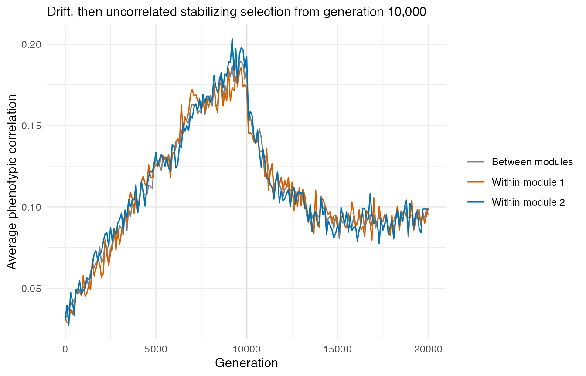
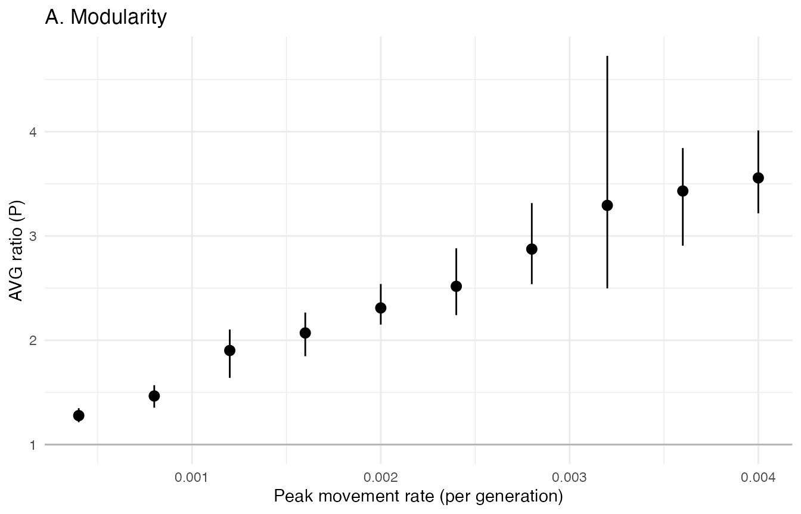
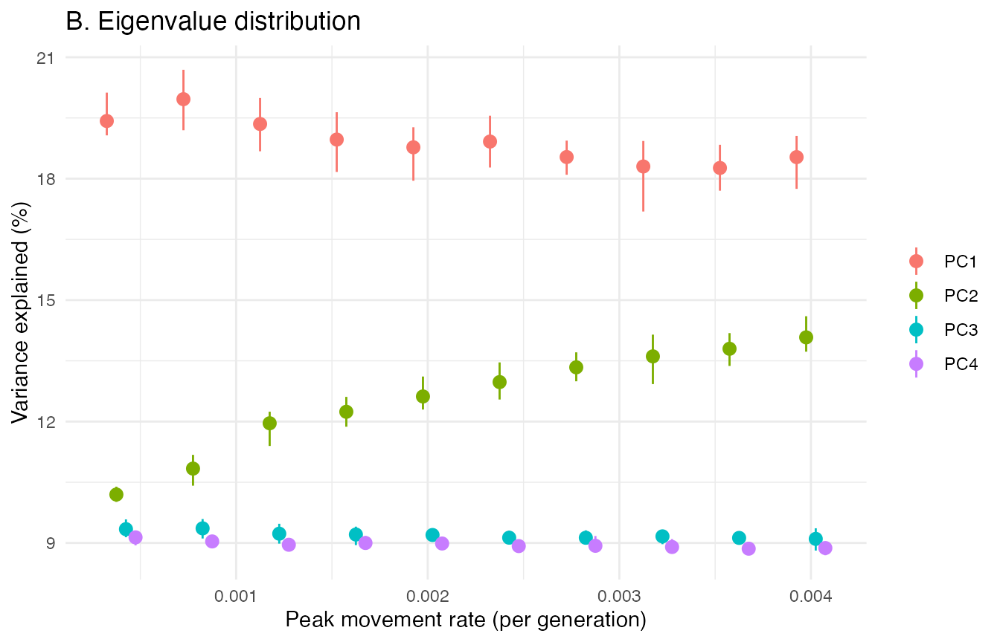
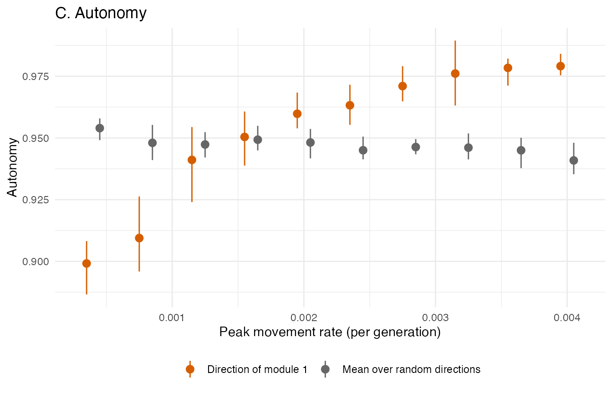
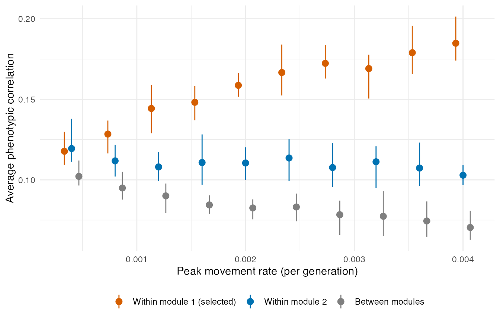
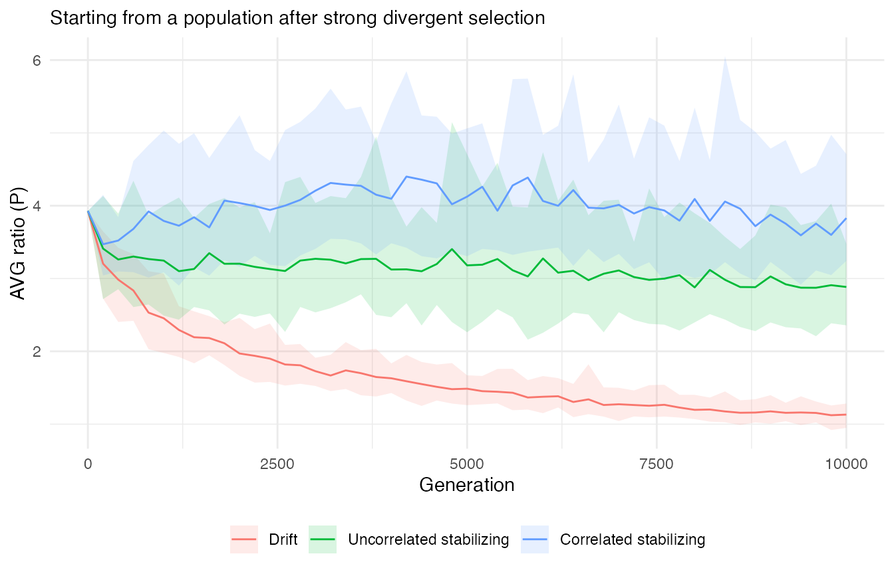

# Reproducing Melo & Marroig (2015)

Melo & Marroig (2015, *PNAS* 112: 470-475,
[doi:10.1073/pnas.1322632112](https://doi.org/10.1073/pnas.1322632112))
showed in individual-based simulations that directional selection can
drive the evolution of modularity: when two groups of traits are pushed
in different directions, genetic and phenotypic correlations within each
group are kept while correlations between the groups disappear. This
vignette describes how to repeat those simulations with evomod2 and
shows the results of a full run, stored in the package.

The simulations take about 40 minutes per population and 2 GB of memory,
so the code below is not run when the vignette is built. The script
`melo_marroig_2015.R` in `system.file("examples", package = "evomod2")`
runs every step from the command line, one population per process.

## Model

Ten traits form two potential modules, traits 1-5 and 6-10. Each of 500
diploid loci has an allelic effect \\y\\ and a column of the binary
matrix \\B\\ that says which traits it affects
([`binary_b()`](https://diogro.github.io/evomod2/reference/architectures.md);
Wagner 1989). With the parameters of the paper:

``` r

library(evomod2)

model <- evomod_model(
  binary_b(loci = 500, traits = 10, init_b = 0.25, init_y = "mutations"),
  binary_b_mutation(rate = 5e-4,     # per allele per generation
                    sd = 0.02,       # mutational effects on y
                    rate_b = 1e-4,   # per entry of B per generation
                    b_mutation = "random"),
  env_sd = 0.8, init_sd = 0.02)

omega_uncorrelated <- diag(10, 10)
omega_correlated <- 10 * (kronecker(diag(2), matrix(0.8, 5, 5)) + diag(0.2, 10))
```

A few details follow the C code used for the paper rather than its text:

- The paper gives 0.02 and 0.8 as the mutational and environmental
  *variances*; the C code used them as standard deviations, and so does
  this reproduction.
- In the C code, a mutation of \\B\\ set the entry to a random value, so
  entries changed at half the nominal rate. `b_mutation = "random"`
  reproduces this; the default, `"flip"`, always changes the entry.
- New populations start like the C code’s: a quarter of the entries of
  \\B\\ equal to 1, and allelic effects built from random mutations
  (`init_y = "mutations"`).

The correlated fitness surface has variances \\\Omega\_{ii} = 10\\ and a
correlation of 0.8 between traits of the same module, none between
modules.

## Protocol

All experiments start from the same population, after 10,000 generations
of drift and 10,000 of uncorrelated stabilizing selection:

``` r

burnin <- evolve(model, n = 5000, record_every = 100, seed = 2015,
                 regimes = list(drift(10000),
                                stabilizing(10000, omega = omega_uncorrelated)))
```

**Divergent selection** (Fig. 2 of the paper): the optimum of traits 1-5
moves up and that of traits 6-10 down, at rates from 0.0004 to 0.004 per
generation, on the correlated fitness surface, for 10,000 generations:

``` r

rate <- 0.002
divergent <- evolve(burnin, directional(10000, delta_theta = rate * rep(c(1, -1), each = 5),
                                        omega = omega_correlated))
```

**Corridor selection** (Fig. 3): only the optimum of module 1 moves,
\\\Delta\theta = r\\(1, 1, 1, 1, 1, 0, 0, 0, 0, 0)\\ for a rate \\r\\
(`delta_theta = rate * rep(c(1, 0), each = 5)`).

**Maintenance** (Fig. 4): starting from a population after 10,000
generations of strong divergent selection (rate 0.004), 10,000
generations of drift, uncorrelated stabilizing selection or correlated
stabilizing selection.

The statistics are those of the paper, computed on the phenotypic (P)
matrices at the end of each run:

- the **AVG ratio**, the average correlation within modules over the
  average correlation between modules
  ([`avg_corr()`](https://diogro.github.io/evomod2/reference/avg_corr.md));
- the **proportion of variance** on each principal component
  ([`eigen_variance()`](https://diogro.github.io/evomod2/reference/matrix_statistics.md));
- the **autonomy** in the direction of module 1 and its mean over random
  directions
  ([`autonomy()`](https://diogro.github.io/evomod2/reference/matrix_statistics.md),
  [`mean_autonomy()`](https://diogro.github.io/evomod2/reference/matrix_statistics.md)).

The stored results have 10 replicate populations per rate (as in the
paper) for divergent and corridor selection, at 10 rates, and 20
replicates per regime for maintenance (100 in the paper). Error bars
below are 2.5% and 97.5% quantiles over replicates, as in the paper.

## Results

### Burn-in

During the burn-in, correlations within and between the (still
hypothetical) modules are similar: there is no modularity before
directional selection.

``` r

b <- P[P$experiment == "burnin", ]
b <- rbind(data.frame(generation = b$generation, value = b$within_1, correlation = "Within module 1"),
           data.frame(generation = b$generation, value = b$within_2, correlation = "Within module 2"),
           data.frame(generation = b$generation, value = b$between, correlation = "Between modules"))
ggplot(b, aes(generation, value, colour = correlation)) +
  geom_vline(xintercept = 10000, colour = "grey85") +
  geom_line() +
  scale_colour_manual(values = c("grey50", "#D55E00", "#0072B2"), name = NULL) +
  labs(x = "Generation", y = "Average phenotypic correlation",
       subtitle = "Drift, then uncorrelated stabilizing selection from generation 10,000")
```



Heritabilities at the end of the burn-in:

``` r

round(res$burnin_h2$h2, 2)
#>  [1] 0.35 0.36 0.34 0.35 0.35 0.35 0.38 0.34 0.36 0.34
```

### Divergent directional selection (Fig. 2)

``` r

div <- P[P$experiment == "divergent", ]
ggplot(summ(div, "avg_ratio"), aes(rate, mean)) +
  geom_hline(yintercept = 1, colour = "grey70") +
  geom_pointrange(aes(ymin = lo, ymax = hi)) +
  rate_axis + labs(y = "AVG ratio (P)", title = "A. Modularity")
```



``` r

eig <- summ(div, paste0("eigen_", 1:4))
eig$statistic <- sub("eigen_", "PC", eig$statistic)
ggplot(eig, aes(rate, 100 * mean, colour = statistic)) +
  geom_pointrange(aes(ymin = 100 * lo, ymax = 100 * hi), position = position_dodge(width = 0.0002)) +
  rate_axis + labs(y = "Variance explained (%)", colour = NULL,
                   title = "B. Eigenvalue distribution")
```



``` r

aut <- summ(div, c("autonomy_module", "autonomy_mean"))
aut$statistic <- factor(aut$statistic, c("autonomy_module", "autonomy_mean"),
                        c("Direction of module 1", "Mean over random directions"))
ggplot(aut, aes(rate, mean, colour = statistic)) +
  geom_pointrange(aes(ymin = lo, ymax = hi), position = position_dodge(width = 0.0002)) +
  scale_colour_manual(values = c("#D55E00", "grey40"), name = NULL) +
  rate_axis + labs(y = "Autonomy", title = "C. Autonomy") +
  theme(legend.position = "bottom")
```



### Corridor selection (Fig. 3)

``` r

cor_runs <- P[P$experiment == "corridor", ]
cs <- summ(cor_runs, c("within_1", "within_2", "between"))
cs$statistic <- factor(cs$statistic, c("within_1", "within_2", "between"),
                       c("Within module 1 (selected)", "Within module 2", "Between modules"))
ggplot(cs, aes(rate, mean, colour = statistic)) +
  geom_pointrange(aes(ymin = lo, ymax = hi), position = position_dodge(width = 0.0002)) +
  scale_colour_manual(values = c("#D55E00", "#0072B2", "grey50"), name = NULL) +
  rate_axis + labs(y = "Average phenotypic correlation") +
  theme(legend.position = "bottom")
```



### Maintenance of modularity (Fig. 4)

``` r

mt <- P[P$experiment == "maintenance", ]
mt$regime <- factor(mt$regime, c("drift", "uncorrelated", "correlated"),
                    c("Drift", "Uncorrelated stabilizing", "Correlated stabilizing"))
ms <- aggregate(avg_ratio ~ regime + generation, mt,
                function(x) c(mean = mean(x), lo = unname(quantile(x, 0.025)),
                              hi = unname(quantile(x, 0.975))))
ms <- data.frame(ms[c("regime", "generation")], ms$avg_ratio)
ggplot(ms, aes(generation, mean, colour = regime, fill = regime)) +
  geom_ribbon(aes(ymin = lo, ymax = hi), alpha = 0.15, colour = NA) +
  geom_line() +
  labs(x = "Generation", y = "AVG ratio (P)", colour = NULL, fill = NULL,
       subtitle = "Starting from a population after strong divergent selection") +
  theme(legend.position = "bottom")
```



## How the reproduction compares

- **Before directional selection there is no modularity**: at the end of
  the burn-in the AVG ratio is about 1, and heritabilities are 0.34-0.38
  (0.3-0.5 in the paper).
- **Divergent selection produces modularity, more so when the optimum
  moves faster** (Fig. 2): from a peak movement rate of 0.0004 to 0.0040
  per generation, the AVG ratio rises from 1.28 to 3.56, the correlation
  between modules falls from 0.093 to 0.044, the proportion of variance
  on the second principal component (the contrast between modules) rises
  from 10.2% to 14.1%, and the autonomy in the direction of module 1
  rises from 0.90 to 0.98 while the mean autonomy stays at about 0.95.
- **Corridor selection integrates the selected module** (Fig. 3): the
  correlation within module 1 rises from 0.12 to 0.18, the module under
  stabilizing selection stays at about 0.11 (the paper describes a
  slight increase), and correlations between modules fall from 0.10 to
  0.07.
- **Once established, modularity is kept by correlated stabilizing
  selection and lost under drift** (Fig. 4): starting from an AVG ratio
  of 3.93, after 10,000 generations it is 3.83 under correlated
  stabilizing selection, 2.88 under uncorrelated stabilizing selection
  and 1.13 under drift.
- The paper reports that between-module correlations drop to nearly zero
  under strong selection; here they reach 0.04. All phenotypic
  correlations are low in this model, because environmental variance
  makes up about two thirds of the phenotypic variance.

The stored results have fewer replicate populations than the paper for
the maintenance experiment (20 per regime instead of 100), and the
maintenance traces are thinned to every 200 generations.

## Running it yourself

``` sh
script=$(Rscript -e 'cat(system.file("examples", "melo_marroig_2015.R", package = "evomod2"))')
Rscript $script burnin results                    # about 80 minutes
Rscript $script divergent 0.002 1 results         # one population, about 40 minutes
Rscript $script corridor 0.002 1 results
Rscript $script divergent 0.004 1 results         # also saves the maintenance seed
Rscript $script maintenance correlated 1 results
Rscript $script summarise results melo_marroig_2015.rds
```

Run the populations in parallel, one process each (for example with
`xargs -P`), then plot the summary as above with
`res <- readRDS("melo_marroig_2015.rds")`.
