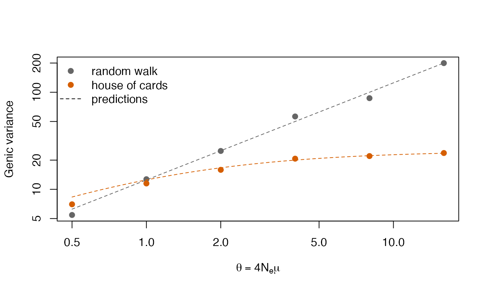
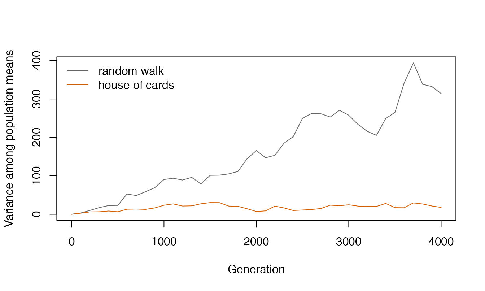
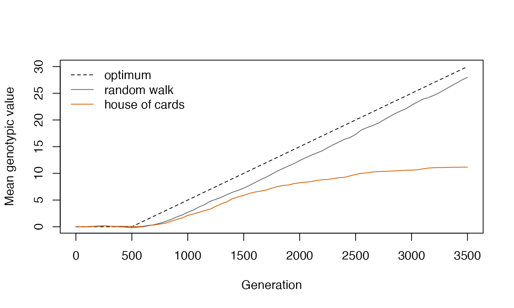

# Mutation models: random walk and house of cards

``` r

library(evomod2)
```

Every mutation model in evomod2 has a `persistence` parameter: a
mutation replaces an allele’s effect `e` by

    persistence * e + draw

where the draw comes from the model’s mutational distribution.

- `persistence = 1` (the default) is a **random walk**: mutational
  effects add up, a new allele resembles its parent, and effects can
  wander arbitrarily far from the reference genotype.
- `persistence = 0` is the **house of cards** model (Kingman 1978;
  Turelli 1984): a mutation replaces the effect with a fresh draw,
  unrelated to the old effect, so allelic effects always come from the
  same distribution. `hoc_mutation(rate, cov)` is a shortcut.
- Values in between pull mutated effects back towards the reference
  genotype (Zeng & Cockerham 1993).

`persistence` works with every architecture: it applies to the effect
vectors of
[`additive()`](https://diogro.github.io/evomod2/reference/architectures.md)
and
[`multilinear()`](https://diogro.github.io/evomod2/reference/architectures.md),
to `y` in
[`binary_b()`](https://diogro.github.io/evomod2/reference/architectures.md)
(entries of `B` still flip), and to the weight and contribution genes of
[`contribution_matrix()`](https://diogro.github.io/evomod2/reference/architectures.md).

``` r

hoc_mutation(rate = 0.001, cov = 0.5)
#> $type
#> [1] "gaussian"
#> 
#> $rate
#> [1] 0.001
#> 
#> $cov
#> [1] 0.5
#> 
#> $persistence
#> [1] 0
#> 
#> attr(,"class")
#> [1] "evomod_mutation"
binary_b_mutation(rate = 0.001, sd = 0.5, rate_b = 0.0001, persistence = 0)
#> $type
#> [1] "binary_b"
#> 
#> $rate
#> [1] 0.001
#> 
#> $sd
#> [1] 0.5
#> 
#> $rate_b
#> [1] 1e-04
#> 
#> $b_mutation
#> [1] "flip"
#> 
#> $random_state
#> [1] FALSE
#> 
#> $persistence
#> [1] 0
#> 
#> attr(,"class")
#> [1] "evomod_mutation"
```

The two models differ when allelic effects are far from the reference
genotype: under drift, and when selection moves the population away from
it.

## Drift: variation within and divergence between populations

Without selection, both models reach a balance between mutation and
drift within a population, but a different one. Two allele copies differ
by the mutations on their lineages since their common ancestor. Under a
random walk these add up, so the genic variance grows in proportion to
`θ = 4 N_e μ` (`L s^2 θ` for `L` loci and mutational standard deviation
`s`; Lande 1976); under the house of cards model only whether a mutation
happened matters, so the variance saturates at `2 L s^2`
(`2 L s^2 θ / (1 + θ)`). `N_e = n` for the default Wright-Fisher life
cycle (about `n / 2` with
[`moran()`](https://diogro.github.io/evomod2/reference/life_cycles.md)):

``` r

n <- 200; loci <- 50; s <- 0.5
thetas <- c(0.5, 1, 2, 4, 8, 16)
equilibrium <- do.call(rbind, lapply(thetas, function(th) {
  sapply(c(random_walk = 1, house_of_cards = 0), function(pers) {
    m <- evomod_model(additive(loci, 1),
                      mutation(rate = th / (4 * n), cov = s, persistence = pers),
                      init_sd = s * sqrt(if (pers == 1) th / 2 else th / (1 + th)))
    pop <- evolve(m, drift(3000), n = n, record_every = 50, seed = 1)
    g <- g_matrices(pop, "genic")
    mean(sapply(g[as.integer(names(g)) > 1000], function(x) x[1, 1]))
  })
}))
matplot(thetas, equilibrium, log = "xy", pch = 19, col = c("grey40", "#D55E00"),
        xlab = expression(theta == 4 * N[e] * mu), ylab = "Genic variance")
curve(loci * s^2 * x, add = TRUE, col = "grey40", lty = 2)
curve(2 * loci * s^2 * x / (1 + x), add = TRUE, col = "#D55E00", lty = 2)
legend("topleft", c("random walk", "house of cards", "predictions"),
       col = c("grey40", "#D55E00", "black"), pch = c(19, 19, NA), lty = c(NA, NA, 2), bty = "n")
```



(Single populations; the package tests check the house of cards
equilibrium for both life cycles with more precision.)

What a random walk leaves unbounded is the population mean: replicate
populations drift apart forever, with the variance among their means
growing linearly in time. Under the house of cards model the mean stays
within the range of the mutational distribution:

``` r

divergence <- sapply(c(random_walk = 1, house_of_cards = 0), function(pers) {
  m <- evomod_model(additive(loci, 1), mutation(rate = 1 / (4 * 100), cov = s, persistence = pers))
  means <- sapply(1:12, function(r)
    trait_means(evolve(m, drift(4000), n = 100, record_every = 100, seed = 100 + r))$mean_x)
  apply(means, 1, var)
})
gens <- seq(0, 4000, by = 100)
matplot(gens, divergence, type = "l", lty = 1, col = c("grey40", "#D55E00"),
        xlab = "Generation", ylab = "Variance among population means")
legend("topleft", c("random walk", "house of cards"), col = c("grey40", "#D55E00"),
       lty = 1, bty = "n")
```



## Stabilizing selection around the reference genotype

When the optimum is at the reference genotype, the alleles that
segregate have small effects, so the old effect matters little and both
models maintain about the same genetic variance:

``` r

stab <- sapply(c(random_walk = 1, house_of_cards = 0), function(pers) {
  m <- evomod_model(additive(50, 1), mutation(rate = 0.0005, cov = 1, persistence = pers),
                    env_sd = 1)
  pop <- evolve(m, stabilizing(3000, omega = 20), n = 500, record_every = 100, seed = 2)
  v <- variances(pop)
  mean(v$G[v$generation > 1500])
})
round(stab, 2)
#>    random_walk house_of_cards 
#>           2.29           2.06
```

## A moving optimum: tracking or stalling

Under directional selection the population has to move away from the
reference genotype. With a random walk, mutations build on the alleles
that selection already favoured, and the population tracks the optimum.
Under the house of cards model every mutation starts again from the same
distribution: going further needs ever rarer alleles from its tail, and
the response stalls:

``` r

moving <- list(stabilizing(500, omega = 20),
               directional(3000, delta_theta = 0.01, omega = 20))
track <- lapply(c(random_walk = 1, house_of_cards = 0), function(pers) {
  m <- evomod_model(additive(50, 1), mutation(rate = 0.0005, cov = 0.05, persistence = pers),
                    env_sd = 1)
  trait_means(evolve(m, moving, n = 500, record_every = 50, seed = 3))
})
plot(track$random_walk$generation, track$random_walk$theta, type = "l", lty = 2,
     xlab = "Generation", ylab = "Mean genotypic value")
lines(track$random_walk$generation, track$random_walk$mean_x, col = "grey40")
lines(track$house_of_cards$generation, track$house_of_cards$mean_x, col = "#D55E00")
legend("topleft", c("optimum", "random walk", "house of cards"),
       col = c("black", "grey40", "#D55E00"), lty = c(2, 1, 1), bty = "n")
```



How far a house of cards population can go depends on the width of the
mutational distribution relative to the distance to travel; with long
directional runs, such as those of Melo & Marroig (2015), the choice of
mutation model is part of the hypothesis being tested.

## References

Kingman, J. F. C. (1978). A simple model for the balance between
selection and mutation. *Journal of Applied Probability*, 15, 1-12.

Turelli, M. (1984). Heritable genetic variation via mutation-selection
balance: Lerch’s zeta meets the abdominal bristle. *Theoretical
Population Biology*, 25, 138-193.

Lande, R. (1976). Natural selection and random genetic drift in
phenotypic evolution. *Evolution*, 30, 314-334.

Zeng, Z.-B., & Cockerham, C. C. (1993). Mutation models and quantitative
genetic variation. *Genetics*, 133, 729-736.
